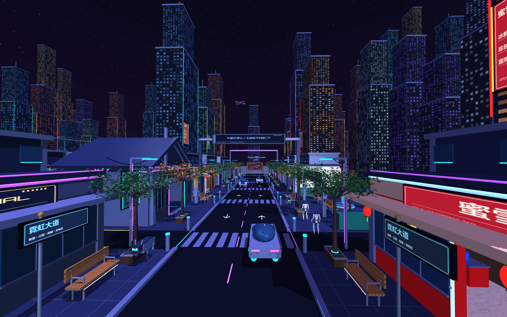
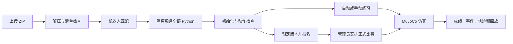

# NEON ARENA

基于 **MuJoCo + Unitree G1** 的具身智能机器人竞赛平台。选手上传机器人的“大脑”，平台提供统一本体、RGB-D 观测、关节控制、城市世界与裁判，运行后把真实成绩、行为事件和回放返回网页。



## 已实现

- 邀请码注册、管理员与选手账号、会话管理。
- ZIP 上传、自动解压、不可覆盖版本和原包 SHA-256。
- 入口与机器人检查；在隔离环境内编译包内全部 Python 文件，再实际导入策略、验证动作。
- G1 29 关节位置控制，支持声明模型输出关节顺序并按名称自动重排。
- 可选“检查通过后自动开始城市练习”：自动完成检查、排队、仿真并返回结果。
- 可直接上传的 G1 行走与深度避障入门包，包含离线 ONNX 权重和上游许可证。
- 同版本两个独立实例练习，或自己的历史版本对战；提供运行诊断、响应耗时曲线与版本比较。
- 正式报名锁定版本；自动生成多随机布局的循环赛，交换出生位置和私人任务组，发布赛事总排行榜。
- 原 CPU 环境与新增 PyTorch CPU 环境并存；CUDA 环境只有实际通过设备推理检测后才允许发布。
- 每日自动备份数据库与提交 ZIP、到期练习文件清理、站内告警、重启恢复及原版本重试。
- 管理员“一键部署并自检”：检查资源、启动执行引擎、准备固定镜像，并验证真实 MuJoCo／RGB-D／双策略通信。
- 实际多视角网页回放、事件、私有日志和复现清单；完整动作与状态轨迹保存在服务器。

**当前定位：单机局域网试赛，CPU 推理，同时运行一局。** 练习是策略评测，不会自动优化模型参数或生成新权重。提供多环境发布和赛事积分榜。GPU 部署入口已经实现，实际可用性取决于 NVIDIA 设备和容器运行时；本机未通过 GPU 验收。模型训练循环不在这一版范围内。

## 快速开始：Windows

Windows 一键部署使用 **Python 3.13**，并需要已安装的 **Docker Desktop（Linux 引擎）**。安装阶段需要联网，策略推理离线运行。MuJoCo 图像渲染需要可用的图形驱动；本项目已在 Windows 实际验证。

```powershell
git clone https://github.com/THUzzz25/neon-arena.git
cd neon-arena
```

双击根目录 **`一键部署.cmd`**。它会创建 Python 环境、安装固定依赖、下载并校验资源、准备策略镜像、完成真实仿真通信自检，再启动网页：<http://127.0.0.1:8765>。

首次在服务器本机设置管理员，**没有默认密码**。管理员生成邀请码，选手注册后即可提交代码。

已经部署过时，双击 **`启动选手平台.cmd`** 即可。平台独立后台运行，关闭启动窗口不会停服，重复点击不会重复启动。电脑重启后仍需点击启动器，没有设置开机自启。

网页正常但仿真排队等待时，到 **比赛管理 → 运行环境 → 一键部署并自检**。部署保留队列，当前场次需要结束后再部署。未安装 Docker Desktop 时，需要先完成其安装。

其他设备使用服务器的局域网 IP 与 `:8765` 访问，系统防火墙需要允许局域网连接。启动器不自动修改防火墙或配置公网访问。

## 选手如何提交

初学者可以先从网页下载「入门行走包」，原样上传并发起房间练习。包内 `starter.json` 可设置前进速度和简单深度避障；它不包含完整搜索、瞄准和自主起身。需要从零实现时使用最小接口模板。

编写策略、放入离线权重并重新打包：

```text
submission.zip
├── submission.json
├── policy.py
├── robot.json
├── README.md
├── models/
└── src/
```

```python
class Policy:
    def __init__(self, player_id=0, config=None):
        self.player_id = player_id

    def act(self, observation):
        return {
            "joint_targets": observation["proprio"]["q"].copy(),
            "fire": False,
        }
```

这个示例仅验证通信，不能保证站立、行走或搜索。参赛者需要实现自己的运控、视觉识别与决策。

- [提交格式、机器人适配、关节重排和常见错误](docs/SUBMISSION_GUIDE.md)
- [完整观测与动作接口](docs/INTERFACE.md)
- [管理员、账号、部署和回放说明](docs/WEB_PLATFORM.md)

### 机器人适配

本体为 `unitree_g1_29dof`，动作是 **29 个有限的关节位置目标、rad 单位、布尔开火标志**。默认按观测 `proprio.joint_names` 排列；模型顺序不同，可在清单中声明完整 `action_joint_names`，平台按名称重排。

平台不会猜测归一化尺度、把力矩转换成位置或自动补齐 12／23 关节策略。状态拼接、历史帧、视觉预处理、动作尺度和初始姿态还原由策略负责。模板内 `robot.json` 提供公开的本体与 PD 参数。

### 从上传到结果



编译或接口失败时返回具体错误。节点未就绪时保留上传和队列，部署恢复后继续。选手代码始终在隔离环境运行。

## 运行环境与信息边界

统一环境 `arena-python-v1`：Python 3.13、NumPy 2.5.5、Pillow 13.0.0、ONNX Runtime 1.32.0，CPU 推理。没有默认安装 PyTorch、OpenCV 或 CUDA。

每份策略使用独立、非 root、只读、禁外网的 Linux 容器，并限制 CPU、内存与进程数。只挂载自己的提交；与仿真通过受限 JSON／数值数组交换数据，不使用跨边界 pickle。

| 项目 | 默认值 |
| --- | --- |
| 本体 / 控制 / 图像 | G1 29 关节 / 50 Hz / RGB-D 10 Hz |
| ZIP / 解压后 | 128 / 512 MB |
| 每策略 CPU / 内存 | 1 核 / 1024 MB |
| 初始化 / 单次响应 | 90 / 1 秒 |
| 练习 / 实际运行上限 | 60 仿真秒 / 900 实际秒 |
| 并行局数 / 每人未完成练习 | 1 局 / 2 局 |
| 网页录像 / 完整轨迹 | 2 Hz / 控制周期记录 |

环境首次使用后固定镜像摘要；部署复用该摘要，依赖更新不能覆盖已使用的同名环境。管理员可在运行环境页面构建、实际验证并发布预定义的 PyTorch CPU 或 CUDA 环境；选手在清单中选择已发布环境。双方环境不同则不能对局。依赖申请用于收集意见，不执行选手的安装脚本。

| 环境 | 推理框架 | 设备 / 默认内存 |
| --- | --- | --- |
| `arena-python-v1` | ONNX Runtime 1.32.0 / NumPy / Pillow | CPU / 1024 MB |
| `arena-torch-cpu-v1` | 上述库 + PyTorch 2.7.0 | CPU / 2048 MB |
| `arena-cuda-v1` | PyTorch 2.7.0 cu128 + ONNX Runtime GPU 1.32.0 | NVIDIA GPU / 4096 MB 主机内存 |

GPU 环境为两个策略分配同一可见设备，目前不提供显存硬配额；正式评测应固定节点和硬件配置。GPU 环境检测失败时不发布，也不会偷偷回退成 CPU。

代码、模型、练习和私人日志仅本人与管理员可见。正式成绩及回放由管理员发布后对平台内选手开放，不公开代码、模型和私人报错。完整复现清单由管理员保管，选手版隐藏布局种子。

当前隔离验证适用于管理员控制的局域网试赛，不等于完成公网负载、容器逃逸审计或生产运维验收。

## 场景与规则

默认城市约 **61.2×66 米**，两条主街、20 个可进入区域、80 个候选藏点，包含商铺、酒店、网吧、五金店、公园、教堂和充电区。悬浮车、巡逻机器人、机械狗、分层无人机与空轨列车按固定程序运动。

新版城市任务包含杯子、饮料瓶、包裹盒、球和罐子，配有对应参考图与同色异形干扰物；历史 `legacy` 任务集保持兼容。策略根据摄像头与深度寻找物品，以手部姿态控制模拟枪的射线。裁判处理目标得分、误击自损、命中对手扣血与短时禁火、车辆接触惩罚，以及 10 仿真秒未起身后的复位。详见 [城市说明](docs/CYBER_CITY.md) 与 [默认配置](configs/default.toml)。

城市目前没有实时速度保证，内部演示和通信模板不替代参赛者的自主行走、搜索与避车算法。

## 开发与验收

```powershell
# 开发和测试依赖
.\.venv\Scripts\python.exe -m pip install -e ".[demo,web,test]"

# 单元、权限、接口、裁判和场景检查
.\.venv\Scripts\python.exe -m pytest -q

# 真实 Docker + MuJoCo 验收，使用独立测试数据
.\.venv\Scripts\python.exe scripts\validate_platform.py

# 浏览器回归，需要 Node.js 与本机 Chrome
node scripts\check_platform_browser.mjs

# 前台网页调试
.\.venv\Scripts\python.exe -m embodied_arena.platform

# 原生仿真与轨迹回放
.\.venv\Scripts\python.exe -m embodied_arena run --viewer --realtime
.\.venv\Scripts\python.exe -m embodied_arena replay artifacts\latest
```

完整 60 秒城市对局与循环赛验收使用 `python scripts/validate_release.py`，报告写入 `artifacts/release_validation/latest.json`。

验收账号和输出在 `artifacts/platform_validation/`，不写入正式账号库。验证范围见 [STATUS](docs/STATUS.md)。原生 CLI 仍只面向本地受信策略；网页上传代码使用独立容器。

Linux 可手动安装依赖、下载资源、构建镜像并运行 `python -m embodied_arena.platform`，图像渲染需要 OpenGL/EGL。目标 GPU 主机仍需实际验收。

## 目录与数据

| 目录 | 用途 |
| --- | --- |
| `embodied_arena/` | 城市、本体、物理、裁判与策略接口 |
| `embodied_arena/platform/` | 网页、权限、队列和隔离运行器 |
| `configs/` | 本体参数与比赛配置 |
| `runtime/` | 固定策略镜像 |
| `scripts/` | 部署、启动、资源获取与验收 |
| `docs/` | 参赛、接口、管理员和场景说明 |
| `assets/` | 程序化街区贴图 |
| `third_party/` | 下载的上游资源，不纳入 Git |
| `var/` | 正式数据库、提交、日志与结果，不纳入 Git |
| `artifacts/` | 测试与演示输出，不纳入 Git |

`ARENA_DATA` 可指定数据目录，`ARENA_POLICY_IMAGE` 指定镜像标记，`ARENA_ALLOWED_HOSTS` 添加自定义主机名。后台启动器读取当前 Windows 用户的持久环境配置。

## 公平赛、调试与后台维护

管理员在「赛事与总榜」选择已报名的 2–16 名选手，设置 1–5 组布局；每组选手每组布局安排两局，同布局交换出生位置与私人任务组。创建时固定提交版本。全部场次完成后统一发布。积分为胜 3、平 1、负 0；依次比较积分、任务净分、任务总分，再相同则并列。

练习页面可比较两次运行的得分、剩余生命和实际用时。「运行诊断」提供每名选手的平均／95 分位／最大响应耗时、生命曲线、耗时曲线和裁判事件计数；私人日志继续受原权限保护。

服务重启后，原运行使用相同提交、种子和出生配置重新排队，最多自动恢复两次；这不是从物理中间状态续跑。失败或中断的场次可按原配置重试。网页传输缓存重复图像与参考图，控制 50 Hz、图像 10 Hz 保持不变；统一关闭策略摄像头的阴影渲染以减少开销，真实深度和物理遮挡保留。是否实时以目标设备实测为准。

每天备份数据库和提交 ZIP 到 `var/platform/backups/`，保留最近 7 份完整快照。超过 30 天的终止练习清理画面和日志，保留成绩与统计；正式比赛文件保留。磁盘不足、维护失败和场次运行失败进入管理员站内告警。「后台维护」支持立即备份和到期清理。

备份在同一块磁盘，不替代异地备份；快照包含账号、提交和成绩，不包含回放。恢复时先停止目标服务，恢复到**全新目录**：

```powershell
.\.venv\Scripts\python.exe scripts\restore_platform.py var\platform\backups\某份快照 var\restored-platform
$env:ARENA_DATA = (Resolve-Path var\restored-platform).Path
.\.venv\Scripts\python.exe -m embodied_arena.platform
```

恢复校验原包 SHA-256、重新安全解压、保留账号密码并撤销旧会话。已有目录不会覆盖。恢复后的历史回放显示不可用；当前数据目录里的原始回放另行备份。

## 第三方资源与许可

本体使用 MuJoCo Menagerie 的 G1；内部演示使用 Amazon FAR Holosoma 的 29-DoF ONNX 运控，另保留 Unitree RL Gym 的转移调研。城市模型与贴图由本项目程序化生成。

来源、固定版本和许可证见 [THIRD_PARTY.md](THIRD_PARTY.md) 与 [assets.lock.json](assets.lock.json)。仓库不上传账号、选手提交、比赛数据、虚拟环境或下载的第三方权重。项目自有代码尚未单独指定开放许可；第三方内容继续遵循各自许可。
